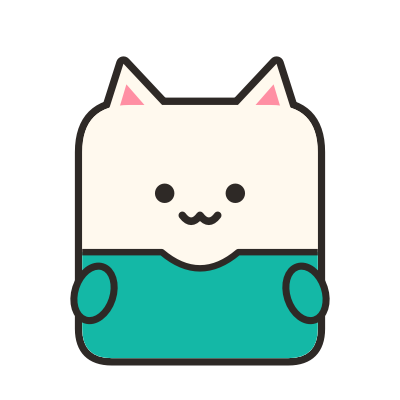
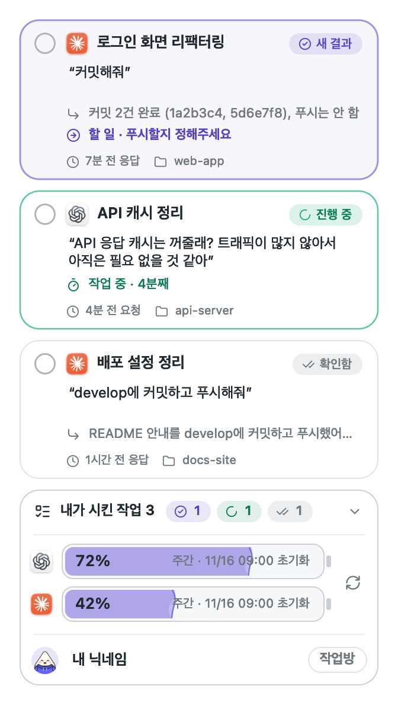
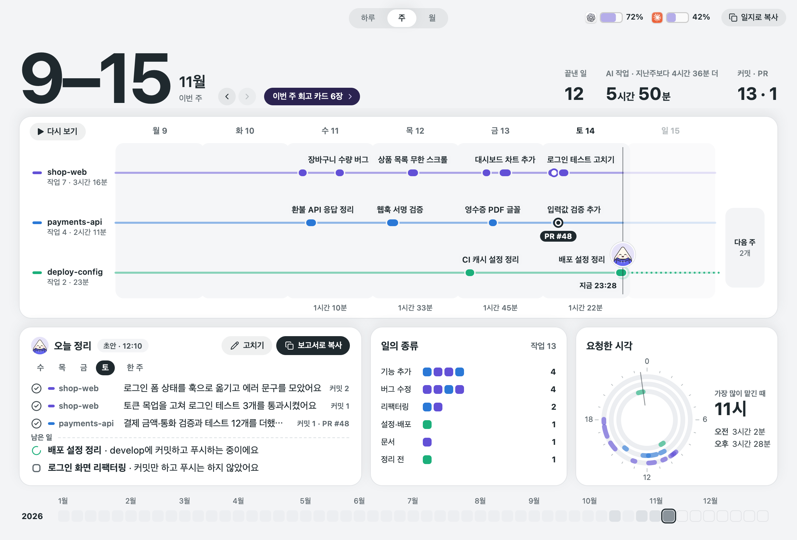
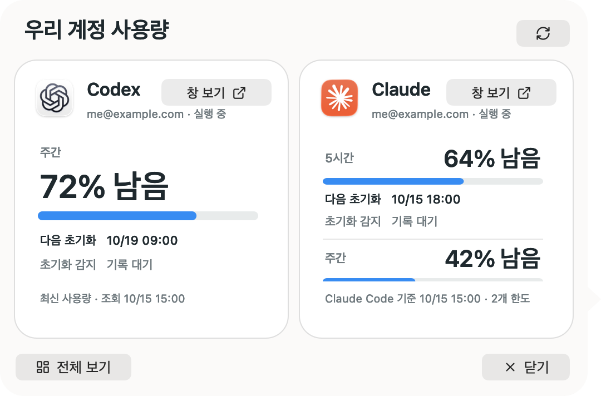
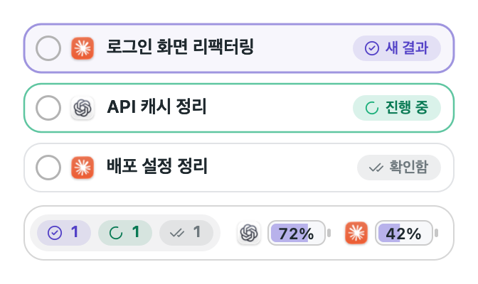
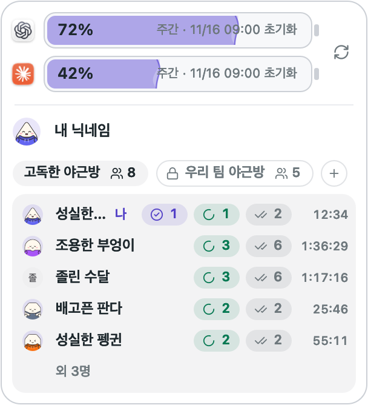
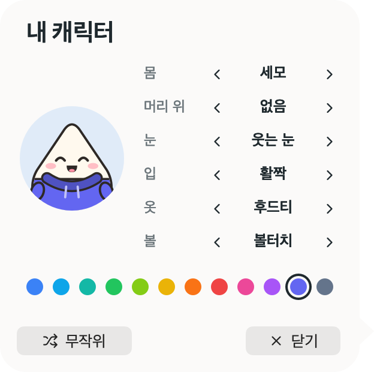

<p align="center">
  
  
  
  
  
  
</p>

<h1 align="center">Errand</h1>

<p align="center"><b>Codex와 Claude에 맡겨둔 심부름을 챙겨주는 작은 맥 앱</b></p>

<p align="center">
AI에게 일을 맡기고 다른 일을 하다 보면, 뭘 시켰는지 잊고 사용량이 바닥난 것도 뒤늦게 알게 됩니다.<br>
Errand는 시킨 일과 남은 사용량을 바탕화면 한쪽에 계속 띄워 두고, 한 일은 하루, 주, 월 단위로 정리해 보여줍니다.
</p>

<p align="center"></p>

## 심부름꾼들을 소개할게요

<table>
  <tr>
    <td width="112" align="center"></td>
    <td><b>"시킨 일은 제가 기억할게요."</b><br>Codex와 Claude에 보낸 요청이 카드로 쌓입니다. 직접 체크하기 전까지는 사라지지 않아서, 맡겨둔 일을 놓치지 않아요.</td>
  </tr>
  <tr>
    <td align="center"></td>
    <td><b>"남은 양은 제가 지켜볼게요."</b><br>두 서비스의 남은 사용량을 배터리처럼 보여주고, 언제 초기화되는지도 알려줍니다.</td>
  </tr>
  <tr>
    <td align="center"></td>
    <td><b>"결과가 나오면 바로 데려다드려요."</b><br>카드를 누르면 그 대화가 Codex나 Claude에서 바로 열립니다.</td>
  </tr>
  <tr>
    <td align="center"></td>
    <td><b>"한 일을 모아 보여드려요."</b><br>맡긴 일을 하루, 주, 월 단위의 노선도로 보여줍니다. 자동 요약을 켜면 한 일과 남은 일도 정리해 줍니다.</td>
  </tr>
  <tr>
    <td align="center"></td>
    <td><b>"혼자 일해도 같이 일하는 기분으로요."</b><br>작업방에 들어가면 다른 사람들이 몇 개의 일을 돌리고 있는지만 보이고, 내 캐릭터가 함께 앉아 있습니다.</td>
  </tr>
  <tr>
    <td align="center"></td>
    <td><b>"작업 내용은 작업방에 보내지 않아요."</b><br>작업방에 작업 내용은 보내지 않습니다. 작업방에 전하는 것은 AI 작업 개수와 캐릭터, 비공개 방에서의 닉네임뿐입니다. AI가 글을 만들 때만 선택한 로컬 CLI가 내용을 해당 모델 서비스로 보냅니다: 첨부 작업의 제목에는 첨부 내용, 하루 정리에는 그날 작업의 요청·답변 일부와 커밋 메시지, 결과 번역에는 그 결과입니다. 로그인 토큰은 복사하거나 바꾸지 않습니다.</td>
  </tr>
</table>

## 화면

<table>
  <tr>
    <td align="center"><br>작업 기록: 프로젝트마다 줄이 하나이고, AI가 일한 동안이 굵은 구간입니다</td>
  </tr>
  <tr>
    <td align="center"><br>남은 사용량: 한도마다 남은 비율과 초기화까지 남은 시간</td>
  </tr>
  <tr>
    <td align="center"><br>간단히 보기: 화면이 작을 때는 카드와 위젯을 한 줄씩으로 줄이거나, 캐릭터만 남길 수 있습니다</td>
  </tr>
  <tr>
    <td align="center"><br>작업방: 캐릭터와 별명, 개수, 들어온 시간만 보입니다</td>
  </tr>
  <tr>
    <td align="center"><br>내 캐릭터는 직접 꾸밀 수 있습니다</td>
  </tr>
</table>

앱이 실제로 그린 화면이고, 내용은 예시 데이터입니다.

## 시작하기

[Releases](https://github.com/ghdcksgml1/errand/releases/latest)에서 `Errand-<버전>.zip`을 받아 풀고, `Errand.app`을 `~/Applications`로 옮겨서 엽니다. macOS 13 이상에서 동작합니다.

로그인을 따로 받지 않고, 이 Mac에 이미 로그인된 계정을 그대로 씁니다.

처음 실행하면 `Errand 시작하기`에서 위젯 사용법을 둘러보고, 현재 계정을 확인한 뒤 AI 서비스·모델과 자동 요약 여부를 선택합니다. 마지막에 설정을 저장하면 작업 기록이 열립니다. **자동 요약은 기본으로 꺼져 있습니다.** `나중에 설정`을 누르면 자동 요약을 끈 채 위젯으로 시작하고, 메뉴 막대의 `설정…`에서 언제든 바꿀 수 있습니다.

- **Codex**: Codex(ChatGPT) 데스크톱 앱에 로그인돼 있으면 바로 보입니다.
- **Claude**: Claude 데스크톱 앱이 있으면 작업 카드는 바로 보이고, 사용량은 앱을 켤 때와 2분마다 받아옵니다. `새로고침`을 누르면 바로 다시 받아옵니다. 터미널에서 Claude Code를 쓴다면 `python3 scripts/connect_claude.py`로 status line도 연결할 수 있습니다.

새 버전이 나오면 위젯의 프로필 옆에 표시됩니다. 누르면 내려받아 서명을 확인한 뒤 앱을 바꾸고 다시 시작합니다. 무엇이 바뀌었는지는 [변경 기록](CHANGELOG.md)에 있습니다.

### 직접 빌드하기

Command Line Tools(`xcode-select --install`)와 [Rust](https://rustup.rs) 1.88 이상이 필요합니다.

```sh
git clone https://github.com/ghdcksgml1/errand.git
cd errand
zsh scripts/build.sh
python3 scripts/install.py --autostart
open ~/Applications/Errand.app
```

새 버전은 `git pull` 뒤에 `zsh scripts/build.sh`와 `python3 scripts/install.py --update`로 올립니다.

## 작업 기록

메뉴 막대나 `남은 사용량` 말풍선의 `작업 기록 열기`로 여는 창입니다. Codex와 Claude에 맡긴 일을 따로 적지 않아도 하루, 주, 월 단위로 볼 수 있습니다.

- **노선도**: 프로젝트마다 줄이 하나이고, AI가 일한 동안이 굵은 구간입니다. PR은 고리와 번호로, 답을 기다리는 일은 주황 점선으로, 진행 중인 일은 내 캐릭터로 보입니다. 요일을 누르면 그 하루로 펼쳐지고, `다시 보기`로 그 기간을 처음부터 다시 그려 봅니다.
- **하루 정리**: 자동 요약을 켜면 지난 작업은 자동으로, 오늘 작업은 오후 6시부터 한 일과 남은 일을 정리합니다. 자동 요약을 끈 상태에서도 직접 요청할 수 있습니다. `보고서로 복사`로 업무 보고 문장으로 가져가고, 한 주는 주간 보고와 여섯 장의 회고 카드로 봅니다.
- **작업 상세**: 작업을 누르면 요청과 결과, 남긴 커밋, 바뀐 파일을 오른쪽 패널에서 봅니다.
- **아침 말풍선**: 자동 요약을 켜면 아침마다 캐릭터가 지난 작업일의 정리를 알려 줍니다.

기록은 각 앱이 이 Mac에 남긴 기록을 읽어 만들고 따로 저장하지 않습니다. 하루 정리를 만들 때는 그날 작업의 요청·답변 일부와 커밋 메시지가 선택한 모델 서비스로 전송되고, 만든 요약만 이 Mac에 저장됩니다. 자동 요약은 기본으로 꺼져 있으며, 설정에서 켜거나 저장된 요약을 지울 수 있습니다. 자세한 내용은 [사용 설명서](docs/guide.md#작업-기록)에 있습니다.

## 파일과 이미지로 작업 등록

메신저 캡처나 파일을 펫 위에 놓으면 등록창이 열립니다. 크게 보기, 간단히 보기, 캐릭터만 보기에서 모두 사용할 수 있습니다. 여러 파일을 한 번에 놓으면 한 작업에 묶입니다.

첨부 미리보기와 필수 제목을 확인한 뒤 **작업 등록**을 누릅니다. AI가 제안한 메모는 옅은 글씨로 표시되며, 메모 칸을 클릭하고 **Tab**을 누르거나 **추천 메모 적용**을 누르면 입력됩니다. 직접 메모를 적어도 됩니다. 등록 전에는 목록에 추가되지 않으며, 취소하면 임시 첨부를 지웁니다. 등록한 카드를 누르면 첨부를 다시 열 수 있고, 작업 완료는 카드의 체크박스와 되돌리기로 처리합니다.

제목과 메모는 로그인된 **Codex 또는 Claude Code CLI**로 제안합니다. 메뉴 막대나 등록창의 **설정**에서 AI 서비스와 모델을 선택합니다. 모델 목록에서 고르거나 모델 ID를 직접 입력할 수 있으며, 서비스마다 마지막으로 저장한 모델을 기억합니다. 설치된 데스크톱 앱의 CLI와 일반 설치 경로를 찾으며, CLI가 없거나 생성에 실패해도 직접 입력할 수 있습니다. 직접 수정한 제목과 메모는 늦게 도착한 AI 응답으로 바뀌지 않습니다. CLI는 컴퓨터에서 실행되지만 추론은 해당 모델 서비스가 처리하며, 해당 계정의 사용량에 반영됩니다.

파일은 한 작업에 최대 12개, 각각 50MB까지 첨부할 수 있습니다. 이미지 제목 생성에는 앞의 이미지 최대 4장을 축소해 사용합니다. 텍스트 파일은 앞부분을, PDF 등 읽을 수 없는 파일은 파일명을 참고합니다. 첨부는 `~/Library/Application Support/Errand/tasks`에 별도로 복사하므로 원본을 옮겨도 유지되며, 개인 첨부 작업의 내용과 개수는 작업방에 보내지 않습니다.

## 더 알아보기

- [사용 설명서](docs/guide.md): 위젯과 크기, 작업 카드, 작업 기록, 사용량, 작업방, 저장되는 내용
- [변경 기록](CHANGELOG.md): 버전마다 바뀐 것
- [개발 문서](docs/development.md): 구조, 빌드와 테스트, 출시

[MIT 라이선스](LICENSE)로 공개합니다. 아이콘은 [Lucide](https://lucide.dev)를 씁니다.

Errand는 개인이 만든 비공식 앱이며 OpenAI, Anthropic과 관계가 없습니다.
